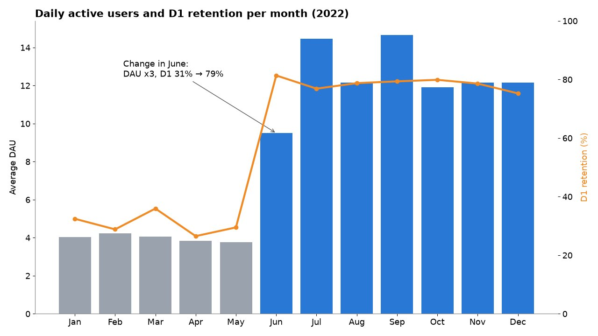
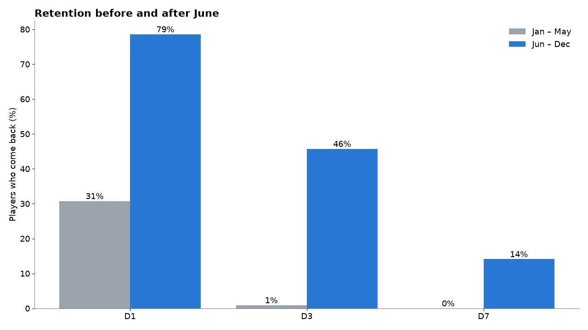
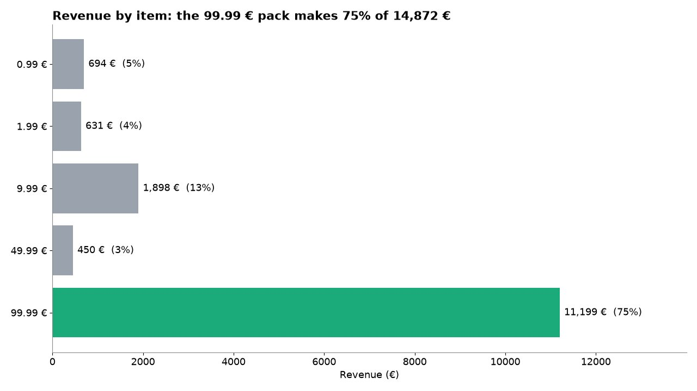

# Game Analytics · SQL | PHP | Unity

An end-to-end game analytics pipeline: a Unity simulator generates player activity, a PHP backend stores it in a SQL database, SQL queries compute the standard F2P KPIs, and an Excel report turns them into insights.



## Pipeline

```
Unity simulator (C#)  ──HTTP──▶  PHP endpoints  ──▶  MySQL database  ──▶  SQL KPI queries  ──▶  Excel analysis
Simulator.cs                     add_user.php         schema.sql            Queries/*.sql          KPIs_Delivery1.xlsx
AnalyticsTracker.cs              add_session.php
                                 end_session.php
                                 add_purchase.php
```

**Dataset:** 1,000 users · 12,505 sessions · 1,329 purchases · 5 shop items · one simulated year (2022)

## KPIs

| KPI | Definition | Query |
|---|---|---|
| DAU | Unique players per day | `Queries/DAU.sql` |
| MAU | Unique players in a rolling 30-day window | `Queries/MAU.sql` |
| Stickiness | DAU / MAU | `Queries/Stickiness.sql` |
| D1 / D3 / D7 retention | % of a day's players who come back 1, 3 and 7 days later | `Queries/D1 D3 D7.sql` |
| ARPU / ARPPU | 30-day revenue per user / per paying user | `Queries/arpu arppu.sql` |
| Sessions & session length | Sessions per user and average duration | `Queries/n sessions and time.sql` |
| Segmentation | KPIs by age, gender and country | `Queries/age and gender.sql` |

## Key findings

- **Something changed in June.** Average DAU roughly tripled (≈4 → 12–14) and D1 retention jumped from 31% to 79% (D7: 0% → 14%).
- **Revenue is concentrated.** The 99.99 € pack generates 75% of total revenue (11,199 € of 14,872 €), and 52% of users made at least one purchase.
- **Monetisation:** ARPU 14.87 € (95% CI 12.47 – 17.27 €), ARPPU 28.65 €. Players aged 26–40 have the highest ARPU (19.53 €).
- **Engagement:** 12.5 sessions per user, with an average session length of about 8.8 minutes.
- **Forecast:** January 2023 revenue was projected from the June–December daily average.




## Repository structure

```
Database/             SQL schema with foreign keys
Delivery1_Simulator/  Unity project that simulates players, sessions and purchases
server/               PHP endpoints that write events to the database
Queries/              SQL queries for every KPI
Excel/                KPI workbook: daily, monthly, demographics, confidence intervals, forecast
docs/                 Charts used in this README
```

## Tech

Unity · C# · PHP · MySQL · SQL · Excel

---

Built as part of the Game Analytics course at CITM-UPC.
